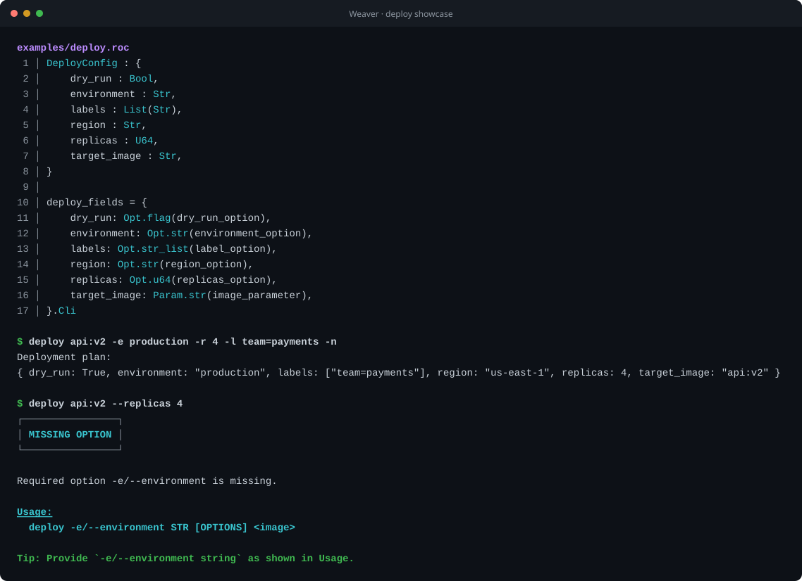

[![Roc-Lang][roc_badge]][roc_link]

[roc_badge]: https://img.shields.io/endpoint?url=https%3A%2F%2Fpastebin.com%2Fraw%2FcFzuCCd7
[roc_link]: https://github.com/roc-lang/roc

Weaver
======

An ergonomic command-line argument parser for the Roc language.

This is a maintained fork of [smores56/weaver](https://github.com/smores56/weaver),
created by Sam Mohr. It keeps weaver working with the current Roc compiler and
publishes tested releases, with their examples, API reference and supply-chain
evidence.

This library aims to provide a convenient interface for parsing CLI arguments
into structured data, in the style of Rust's [clap](https://github.com/clap-rs/clap).
Without code generation at compile time, the closest we can get in Roc is the use of the
[record builder syntax](https://www.roc-lang.org/examples/RecordBuilder/README.html).
This allows us to build our config and parser at the same time, in a type-safe way.

The deployment showcase below comes from the compiled
[`examples/deploy.roc`](./examples/deploy.roc): the same record builder produces
typed data, help text, usage, and actionable diagnostics.



**[Read the manual](https://lukewilliamboswell.github.io/weaver/)** for getting
started, the examples, the API reference of every release, and how to verify a
release's supply-chain evidence.

## Status

This library is ready to parse your args today, but I'm always looking for more testing
from the community! Feel free to open a GitHub issue if there's a feature you're missing
from another CLI parsing library that you think would fit well in Weaver.

## Example

[`examples/basic.roc`](./examples/basic.roc) is a complete program: one record
builder declares an option, a flag, an optional parameter and a list of
parameters, and weaver supplies the parsing, `--help`, `--version` and the
diagnostics. The manual's
[Get started](https://lukewilliamboswell.github.io/weaver/getting-started.html)
chapter has a first program with the latest release's package URL already filled in.

There are more examples in the [examples](./examples)
directory; the manual's [examples chapter](https://lukewilliamboswell.github.io/weaver/examples.html)
describes each one.

## Contributing

See [CONTRIBUTING.md](CONTRIBUTING.md). Everything CI checks runs locally with:

```sh
blueprint run check
```

Report a suspected vulnerability privately, as [SECURITY.md](SECURITY.md) describes.

## License

[UPL-1.0](LICENSE). weaver keeps the MIT notice of the upstream project for the
code that originates there.
